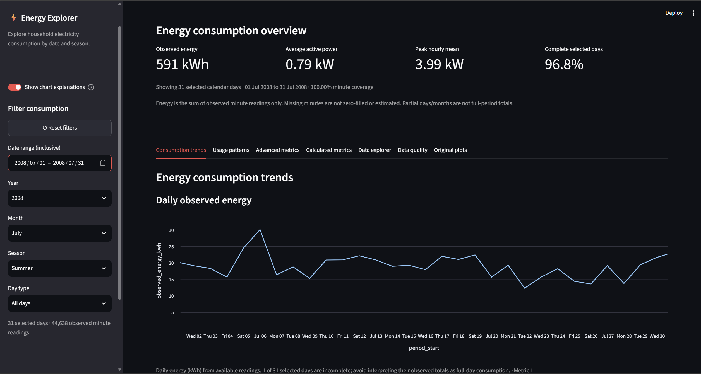
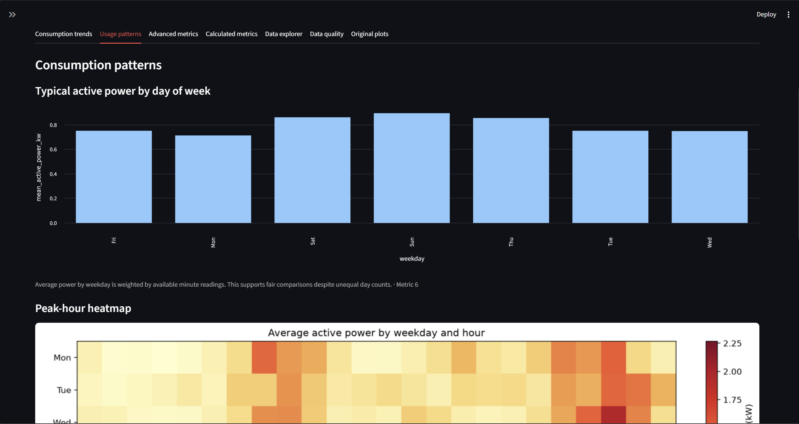
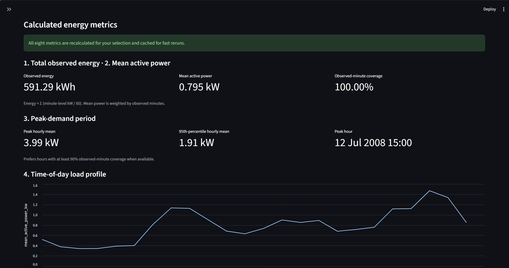
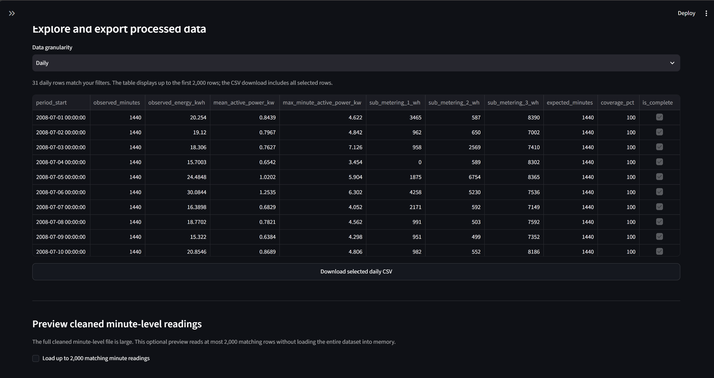

# Household Energy Consumption Analytics Dashboard

An end-to-end Python project that turns two million minute-by-minute readings from a single household into an interactive Streamlit dashboard. It answers the questions an ordinary electricity customer has: *when do I use the most power, how does my usage change across the year, and where does the energy go?*

> **Status:** data pipeline, eight metrics, six charts and the interactive Streamlit dashboard (date, year, month, season and day-type filters, data explorer and CSV export) are complete. Hosted deployment is the remaining item (see [Roadmap](#roadmap)).

---

## Table of contents

1. [Project overview and problem statement](#project-overview-and-problem-statement)
2. [Objectives and proposed solution](#objectives-and-proposed-solution)
3. [Dataset](#dataset)
4. [Technologies used](#technologies-used)
5. [Dashboard features](#dashboard-features)
6. [Folder structure](#folder-structure)
7. [Prerequisites](#prerequisites)
8. [Quick start](#quick-start)
9. [Reproducing the data cleaning and analysis](#reproducing-the-data-cleaning-and-analysis)
10. [Running the tests](#running-the-tests)
11. [Screenshots and deployment](#screenshots-and-deployment)
12. [Roadmap](#roadmap)
13. [Troubleshooting](#troubleshooting)
14. [License](#license)
15. [Acknowledgements](#acknowledgements)

---

## Project overview and problem statement

Households receive an electricity bill with one number on it: the total for the month. That number does not say **when** the energy was used, **which appliances** drove it, or **whether a given week was unusual**. Without that context it is hard to cut costs, shift usage away from peak hours, or spot a fault such as an appliance left running.

Smart-meter data contains the answers, but raw minute-level logs are large, contain gaps, and are unreadable without processing and visualization.

This project cleans a real, public smart-meter dataset, defines a set of practical consumption metrics, and presents them in a dashboard that a non-technical person can read.

## Objectives and proposed solution

**Objectives**

- Clean and validate a large raw time-series dataset without inventing data for the gaps.
- Aggregate it to hourly, daily and monthly levels while recording how complete each period is.
- Define and compute eight energy-consumption metrics that map to real consumer questions.
- Visualize consumption patterns: trends, peak hours, seasonality, appliance mix and anomalies.
- Deliver a reproducible repository that a new team member can run within 30 minutes.

**Solution**

A four-stage pipeline feeds a Streamlit app:

```
raw UCI file  ->  cleaning  ->  aggregation + features  ->  metrics + charts  ->  Streamlit dashboard
(.txt, 127 MB)    (minute CSV)   (hourly / daily / monthly)   (8 metrics, 6 plots)   (tabs, KPI cards)
```

### The eight metrics

| # | Metric | Question it answers |
|---|---|---|
| 1 | Total energy (kWh) | How much did we use in total? |
| 2 | Average active power (kW) | What is the typical load? |
| 3 | Peak-demand period | When is demand highest? |
| 4 | Time-of-day load profile | What does a typical day look like? |
| 5 | Seasonal and monthly trend | How does usage change across the year? |
| 6 | Weekday vs weekend | Do weekends use more or less? |
| 7 | Sub-metering category share | Kitchen, laundry, water heater / AC, or everything else? |
| 8 | Anomaly flag (IQR per hour-of-day baseline) | Which hours were unusually high for that time of day? |

Full definitions, calculation steps and justification are in [`docs/Household_Energy_Metrics_Definition.PDF`](docs/Household_Energy_Metrics_Definition.PDF).

## Dataset

| | |
|---|---|
| **Name** | Individual Household Electric Power Consumption |
| **Source** | UCI Machine Learning Repository |
| **URL** | <https://archive.ics.uci.edu/dataset/235/individual+household+electric+power+consumption> |
| **DOI** | [10.24432/C58K54](https://doi.org/10.24432/C58K54) |
| **Authors** | Georges Hebrail and Alice Berard |
| **License** | CC BY 4.0 |
| **Coverage** | December 2006 to November 2010 (48 months) |
| **Resolution** | One reading per minute, one household in Sceaux, France |
| **Raw size** | 2,075,259 rows, about 127 MB uncompressed |

**Measurements:** global active power (kW), global reactive power (kVAR), voltage (V), global intensity (A), and three sub-meters (Wh): kitchen, laundry, and water heater / air conditioner.

**Data quality, as found and handled**

- 25,979 rows (about 1.25%) have no electrical measurement, stored as `?`. They are **dropped, not imputed**, leaving 2,049,280 valid rows.
- Each hourly, daily and monthly row records `observed_minutes`, `expected_minutes`, `coverage_pct` and `is_complete`. Energy is summed from observed minutes (`kW / 60` kWh per minute), so for incomplete periods it is **observed energy, not a full-period estimate**.
- 504 of 34,589 hourly periods, 84 of 1,442 daily periods and 45 of 48 monthly periods are incomplete.

Detailed inspection notes are in [`docs/Household_Energy_Dataset_Preliminary_Inspection.docx`](docs/Household_Energy_Dataset_Preliminary_Inspection.docx). The comparison of candidate datasets is in [`docs/Household_Energy_Consumption_Dataset_Research.docx`](docs/Household_Energy_Consumption_Dataset_Research.docx).

### Getting the data

**The raw dataset is not stored in this repository** (it is large and freely available). `src/setup_data.py` downloads it from UCI automatically. To do it by hand instead:

1. Download the ZIP from the dataset page above.
2. Extract `household_power_consumption.txt`.
3. Place it at `data/raw/household_power_consumption.txt`.

The repo does include a compressed copy of the cleaned data (about 18 MB) and the three small aggregate CSVs, so the hosted dashboard works without running the pipeline. The 127 MB raw file is still excluded.

## Technologies used

| Area | Tools |
|---|---|
| Language | Python 3.10 or newer |
| Data processing | pandas, NumPy |
| Visualization | Matplotlib, seaborn |
| Dashboard | Streamlit |
| Testing | `unittest`|
| Version control | Git and GitHub |

Exact dependencies are in [`requirements.txt`](requirements.txt).

## Dashboard features

The Streamlit app (`streamlit_app.py`) reads the three compact aggregate files (hourly, daily, monthly) rather than the millions of minute rows, so it starts quickly.

**Interactive filters (Energy Explorer sidebar)**

- Date range (inclusive start and end)
- Year, month and season
- Day type: all days, weekdays or weekends
- *Reset filters* button, plus a live count of the selected days and observed minute readings
- Clear messages for empty or impossible selections (for example, Winter combined with July)

Filters combine as intersections and update the KPI cards, all eight metrics, and every chart except the bundled reference images. Monthly totals are rebuilt from the selected days, not taken from unfiltered calendar months.

**Seven tabs**

| Tab | What it shows |
|---|---|
| Consumption trends | Daily energy and monthly average power for the selection |
| Usage patterns | Weekday vs weekend profile and the hour-by-weekday heatmap |
| Advanced metrics | Sub-metering category share and anomalous hours by month |
| Calculated metrics | Numeric summaries for all eight metrics |
| Data explorer | Hourly, daily or monthly table with an aggregation-level selector, CSV download of the selected rows, and an optional preview of up to 2,000 cleaned minute-level readings |
| Data quality | Coverage figures, formulas, and the findings report download |
| Original plots | The six static charts from `plots/`, unaffected by filters |

**Other**

- Cached data loading (`@st.cache_data`, keyed on file modification time and size), so rerunning the aggregation refreshes the app automatically.
- Input validation with readable error messages if a file is missing or malformed.
- Chart-only fallback: if the aggregate CSVs are absent, the app still shows the six bundled charts.
- The minute-level preview reads `data/processed/household_energy_cleaned.csv`, or the compressed `household_energy_cleaned.csv.gz` that ships in the repo so the hosted app can use it. Without either, the rest of the app still works.

## Folder structure

```
household-energy-consumption-analytics/
├── README.md
├── LICENSE                      
├── requirements.txt
├── .gitignore
├── streamlit_app.py             # dashboard entry point
├── dashboard_filters.py         # filtering and re-aggregation logic for the sidebar (no Streamlit imports)
├── energy_metrics.py            # metric calculations and validation (no Streamlit imports)
├── src/
│   ├── setup_data.py            # downloads the dataset and runs the pipeline
│   ├── household_energy_initial_cleaning.py
│   ├── household_energy_aggregation.py
│   └── household_energy_visualization.py
├── data/
│   ├── raw/                     # raw UCI file goes here (not tracked by Git)
│   └── processed/               # generated CSVs (not tracked by Git)
├── plots/                       # the six generated charts (PNG)
├── docs/                        # research, inspection, metric definitions, findings report
│   └── screenshots/             # dashboard screenshots used in this README
└── tests/
    ├── test_pipeline.py
    ├── test_metrics.py
    └── test_dashboard_filters.py
```

## Prerequisites

- **Python 3.10 or newer**, available on the command line. Check with `python --version` (use `python3` on macOS/Linux).
- **Git**.
- **About 1 GB of free disk space** for the raw file and generated CSVs.
- **An internet connection** for the first run (packages and the dataset).

Time estimate: about 10 to 15 minutes on a typical connection, most of it the dataset download.

## Quick start

### 1. Clone the repository

```bash
git clone https://github.com/Community-Dreams-Foundation-ProjectPool/household-energy-consumption-analytics.git
cd household-energy-consumption-analytics
```

### 2. Create and activate a virtual environment

Windows (PowerShell):

```powershell
python -m venv .venv
.venv\Scripts\Activate.ps1
```

Windows (Command Prompt): `.venv\Scripts\activate.bat`

macOS / Linux:

```bash
python3 -m venv .venv
source .venv/bin/activate
```

If PowerShell blocks activation, run `Set-ExecutionPolicy -Scope Process RemoteSigned` and try again.

### 3. Install dependencies

```bash
pip install -r requirements.txt
```

Optional check that everything imports:

```bash
python -c "import pandas, numpy, matplotlib, seaborn, streamlit; print('OK')"
```

### 4. Prepare the dataset

```bash
python src/setup_data.py
```

This downloads the UCI file into `data/raw/`, then runs cleaning, aggregation and chart generation. It takes about a minute after the download. Re-running it skips work that is already done.

### 5. Launch the dashboard

```bash
python -m streamlit run streamlit_app.py
```

Open <http://localhost:8501> if the browser does not open on its own. Press `Ctrl+C` in the terminal to stop.

## Reproducing the data cleaning and analysis

`setup_data.py` simply runs the three scripts below in order. Run them yourself from the **repository root** to see each stage:

```bash
# 1. Clean: parse Date + Time into a timestamp, rename columns,
#    convert '?' to missing and drop those rows
python src/household_energy_initial_cleaning.py

# 2. Aggregate and add features (hour, day of week, month, season),
#    producing hourly, daily and monthly files with coverage columns
python src/household_energy_aggregation.py

# 3. Generate the six charts into plots/
python src/household_energy_visualization.py
```

| Stage | Reads | Writes |
|---|---|---|
| Cleaning | `data/raw/household_power_consumption.txt` | `data/processed/household_energy_cleaned.csv` |
| Aggregation | cleaned CSV | `household_energy_featured.csv`, `household_energy_hourly.csv`, `household_energy_daily.csv`, `household_energy_monthly.csv` (all in `data/processed/`) |
| Visualization | the featured, hourly, daily and monthly CSVs | `plots/01_...png` to `plots/06_...png` |

The plotting functions in `src/household_energy_visualization.py` return Matplotlib `Figure` objects, so they can be reused in notebooks or in Streamlit with `st.pyplot`. Metric calculations live in `energy_metrics.py`, and the filter logic in `dashboard_filters.py`. The written interpretation of each chart is in [`docs/Household_Energy_Visualization_Findings.docx`](docs/Household_Energy_Visualization_Findings.docx).

## Running the tests

The 15 tests use small synthetic data, so they run without downloading the dataset. They cover the pipeline, the eight metrics, and the filters (date boundaries, partial months, empty selections):

```bash
python -m unittest discover -s tests -v
```

## Screenshots and deployment

**Live dashboard:** _link will be added once the app is deployed_

Screenshots 









## Roadmap

- [x] Dataset selection, inspection and cleaning
- [x] Hourly, daily and monthly aggregation with coverage tracking
- [x] Eight metrics defined and implemented
- [x] Six charts and a findings report
- [x] Streamlit app with cached loading and a metrics tab
- [x] Interactive filters (date range, year, month, season, day type) and a data explorer with CSV export
- [ ] Hosted deployment
- [ ] Download buttons for the charts themselves

## Troubleshooting

| Problem | Fix |
|---|---|
| `ModuleNotFoundError` when running a script | The virtual environment is not active, or your editor is using a different Python. Activate `.venv` and select it as the interpreter. |
| UCI download fails or times out | Download the ZIP manually (see [Getting the data](#getting-the-data)), then rerun `python src/setup_data.py`. |
| App shows charts but no numbers | The processed CSVs are missing. Run `python src/setup_data.py`. |
| Matplotlib fails with a DLL or "Application Control" error on Windows | A security policy is blocking the library. Reinstall in a fresh virtual environment, or run from WSL or Anaconda. |
| Port 8501 is already in use | Add `--server.port 8502` to the `streamlit run` command. |

## License

This project is released under the [MIT License](LICENSE). The source dataset is licensed separately under **CC BY 4.0**; please cite it as below.

## Acknowledgements

Dataset: Hebrail, G. and Berard, A. (2006). *Individual Household Electric Power Consumption* [Dataset]. UCI Machine Learning Repository. <https://doi.org/10.24432/C58K54>

Built as a volunteer project with the CDF project team.
